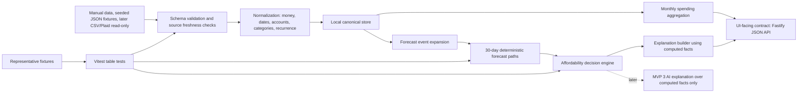

# MVP 0 Backend Design

Status: Living  
Last updated: 2026-08-04

## Purpose

This document defines the MVP 0 backend package for deterministic affordability. It is intentionally backend-only: no UI layout, no visual design, no account writes, and no personalized investment, tax, legal, fiduciary, or payment advice.

MVP 0 should answer "Can I afford this?" from explicit inputs and repeatable calculations before any AI explanation layer exists.

## Scope

In scope:

- Canonical data model for accounts, transactions, income, recurring obligations, goals, planned purchases, freshness, and uncertainty.
- Deterministic 30-day cash-flow forecast.
- Affordability decision result levels, timing rules, buffer rules, reason codes, and explanation payloads.
- Bi-weekly salaried income support and monthly spending-summary aggregation for the initial target user.
- UI-facing service contract that a separate frontend can consume without owning financial logic.
- Fixture and test strategy for repeatable backend validation.

Out of scope:

- Bank account writes, money movement, bill payment, debt settlement, investing, tax, legal, or fiduciary advice.
- AI-generated calculations.
- Live Plaid integration. MVP 0 may shape the future Plaid adapter, but it should run from manual or seeded data.
- UI design.

## Implementation Defaults

| Area | MVP 0 default |
| --- | --- |
| Initial target user | Individual salaried user paid bi-weekly |
| Forecast horizon | 30 calendar days |
| Forecast granularity | Daily forecast events with conservative same-day ordering |
| Spending summary period | Calendar month |
| Currency | Integer minor units, cents for USD |
| Date handling | ISO `YYYY-MM-DD` calendar dates in the user's financial timezone |
| Timestamp handling | ISO 8601 UTC timestamps for freshness and audit fields |
| Purchase timing | Conservative same-day ordering |
| Static cash buffer | `$250.00`, fixture/config driven and visible but read-only to users in MVP 0 |
| Forecast source | Manual or fixture JSON first |
| Decision principle | Use conservative cash path for the decision, keep optimistic paths explanatory |

## Target User And Time Granularity

MVP 0 targets an individual salaried user paid on a bi-weekly cadence. The income model must support bi-weekly recurrence as a first-class cadence, not as a special case derived from monthly averages.

Spending should be summarized and tracked by calendar month because most bills and user budgeting language are monthly. This monthly spending summary is a reporting and pattern-detection aggregation. It does not determine the internal forecast horizon or event granularity.

The internal forecast should stay day-based so the backend can reason about purchases near rent, subscriptions, utilities, goal contributions, and paydays. The MVP 0 backend package uses a 30-calendar-day horizon by explicit design; monthly tracking should not silently decide that horizon.

## Canonical Model Rules

- Store money as integer minor units: `$12.34` is `1234`.
- Use signed amounts only for realized transactions and generated forecast events. Inflows are positive, outflows are negative.
- Store scheduled income, obligations, goals, and planned purchases as positive amounts. The forecast engine converts them to signed events.
- Treat cash-like accounts as spendable. Credit card limits and available credit are not spendable cash in MVP 0.
- Keep source metadata on every imported or inferred object.
- Keep freshness and confidence separate:
  - Freshness answers "how old or complete is this data?"
  - Confidence answers "how certain are we about this inferred or variable fact?"

## Top-Level Snapshot

Every forecast run receives a normalized financial snapshot.

```ts
type FinancialSnapshot = {
  asOfDate: string; // YYYY-MM-DD
  timezone: string; // IANA timezone, for example "America/Chicago"
  currency: string; // ISO 4217, for MVP 0 usually "USD"
  config: ForecastConfig;
  coverage: DataCoverage;
  accounts: Account[];
  transactions: Transaction[];
  incomeSources: IncomeSource[];
  recurringObligations: RecurringObligation[];
  goals: Goal[];
  plannedPurchases: PlannedPurchase[];
};
```

```ts
type ForecastConfig = {
  horizonDays: 30;
  minimumCashBufferCents: number; // default 25000
  staleBalanceHours: number; // default 72 for synced data
  staleManualBalanceDays: number; // default 7 for manual or fixture data
  reliableIncomeConfidence: number; // default 0.8
};

type DataCoverage = {
  balancesDeclaredComplete: boolean;
  incomeDeclaredCompleteThroughDate: string;
  obligationsDeclaredCompleteThroughDate: string;
  transactionsCompleteFromDate?: string;
  userConfirmedNoOtherRequiredObligations: boolean;
};
```

Coverage prevents false precision. If required obligations are not declared complete through the horizon, the result should be `UNKNOWN` unless the scenario is explicitly marked as a partial what-if.

## Shared Types

```ts
type EntitySource = "manual" | "fixture" | "csv" | "plaid" | "inferred";

type FreshnessStatus = "fresh" | "usable" | "stale" | "missing" | "estimated";

type Freshness = {
  status: FreshnessStatus;
  asOf?: string; // ISO timestamp or YYYY-MM-DD, depending on source
  source: EntitySource;
  ageHours?: number;
  warnings: FreshnessWarning[];
};

type FreshnessWarning = {
  code:
    | "BALANCE_STALE"
    | "TRANSACTIONS_INCOMPLETE"
    | "INCOME_COVERAGE_INCOMPLETE"
    | "OBLIGATION_COVERAGE_INCOMPLETE"
    | "MANUAL_DATA_UNCONFIRMED"
    | "ESTIMATED_VALUE";
  severity: "info" | "warning" | "critical";
  message: string;
};

type Uncertainty = {
  confidence: number; // 0.0 to 1.0
  confidenceReason?: string;
  isEstimated: boolean;
  estimateMethod?: "user_entered" | "historical_average" | "merchant_recurrence" | "category_average";
};

type AssumptionCode =
  | "AVAILABLE_BALANCE_MISSING"
  | "CONSERVATIVE_INCOME_MINIMUM_USED"
  | "FLEXIBLE_GOAL_EXCLUDED_FROM_REQUIRED_SOLVENCY"
  | "OPTIONAL_OBLIGATION_EXCLUDED_FROM_REQUIRED_SOLVENCY"
  | "CADENCE_DAY_CLAMPED_TO_MONTH_END"
  | "CONSERVATIVE_SAME_DAY_ORDERING_APPLIED";

type Assumption = {
  code: AssumptionCode;
  severity: "info" | "warning" | "critical";
  message: string;
  relatedEntityIds: string[];
};

type Cadence =
  | { kind: "once" }
  | { kind: "weekly"; intervalWeeks: number; anchorDate: string }
  | { kind: "biweekly"; anchorDate: string }
  | { kind: "semimonthly"; daysOfMonth: [number, number] }
  | { kind: "monthly"; dayOfMonth: number }
  | { kind: "quarterly"; dayOfMonth: number; anchorMonth: number }
  | { kind: "annual"; month: number; dayOfMonth: number };
```

When a cadence day is beyond the number of days in a month, clamp to the last calendar day of that month.

Assumption codes are stable backend contract values. UI copy may map these codes, but must not render backend diagnostic `message` text verbatim.

| Code | Meaning |
| --- | --- |
| `AVAILABLE_BALANCE_MISSING` | A cash account had no available balance, so current balance was used with an explicit assumption. |
| `CONSERVATIVE_INCOME_MINIMUM_USED` | The decision path used minimum expected income rather than expected upside. |
| `FLEXIBLE_GOAL_EXCLUDED_FROM_REQUIRED_SOLVENCY` | A flexible goal was included in the all-events path, not required solvency. |
| `OPTIONAL_OBLIGATION_EXCLUDED_FROM_REQUIRED_SOLVENCY` | An optional obligation was included in the all-events path, not required solvency. |
| `CADENCE_DAY_CLAMPED_TO_MONTH_END` | A cadence day beyond a month length was clamped to the last day of that month. |
| `CONSERVATIVE_SAME_DAY_ORDERING_APPLIED` | Same-day events were applied in conservative decision order. |

Adding a new `AssumptionCode` is a UI/backend contract change and should be coordinated through `coordination/HANDOFFS.md`.

## Accounts

```ts
type Account = {
  id: string;
  displayName: string;
  institutionName?: string;
  type: "checking" | "savings" | "cash" | "credit_card" | "loan" | "investment" | "other";
  role: "spendable_cash" | "reserve_cash" | "liability" | "excluded";
  currency: string;
  currentBalanceCents: number;
  availableBalanceCents?: number;
  creditLimitCents?: number;
  includeInForecast: boolean;
  freshness: Freshness;
  source: EntitySource;
};
```

Forecast opening cash balance:

- Include accounts where `includeInForecast = true` and `role` is `spendable_cash` or `reserve_cash`.
- Prefer `availableBalanceCents` for cash accounts.
- Use `currentBalanceCents` only when available balance does not exist for that account type, and attach an `AVAILABLE_BALANCE_MISSING` assumption.
- Do not count credit limit as spendable cash.

## Transactions

```ts
type Transaction = {
  id: string;
  accountId: string;
  postedDate: string;
  authorizedDate?: string;
  merchantName: string;
  originalDescription?: string;
  amountCents: number; // signed: positive inflow, negative outflow
  currency: string;
  category: string;
  categoryDisplayName?: string;
  categoryRequiredDefault?: boolean;
  normalizedMerchantId?: string;
  merchantCanonical?: string;
  merchantAmbiguity?: boolean;
  flowType: FlowType;
  counterAccountId?: string;
  transferMatchConfidence?: number; // 0.0 to 1.0
  normalizationUncertaintyCodes?: (
    | "unknown_merchant"
    | "ambiguous_processor"
    | "unknown_category"
    | "transfer_like_unpaired"
  )[];
  tags?: (
    | "one_time"
    | "planned_purchase"
    | "required"
    | "reimbursable"
    | "shared_household"
    | "ignore_for_patterns"
    | "optional_service"
  )[];
  recurrenceSignal?: {
    isLikelyRecurring: boolean;
    cadence?: Cadence["kind"];
    confidence: number;
  };
  freshness: Freshness;
  uncertainty: Uncertainty;
  source: EntitySource;
};
```

```ts
type FlowType =
  | "SPEND"
  | "INCOME"
  | "TRANSFER_OUT"
  | "TRANSFER_IN"
  | "REFUND"
  | "FEE"
  | "UNCLASSIFIED";
```

After `D-011`, transactions are the primary product object. `flowType` is backend-owned and required because multi-account aggregation cannot treat every outflow as spending. Matched internal movement uses `counterAccountId` and `transferMatchConfidence`; backend aggregation trusts a transfer only when the counter account is connected and `transferMatchConfidence >= 0.8`. Unpaired or low-confidence transfer-like movement stays `UNCLASSIFIED`; it is neither spending nor silently discarded.

After `S-004`, category and merchant labels are also backend-owned. `categoryDisplayName` and `categoryRequiredDefault` come from the shared taxonomy. `merchantAmbiguity` and `normalizationUncertaintyCodes` let the UI surface processors, unknown merchants, and transfer-like uncertainty without inventing cleanup rules.

Monthly spending summaries should be generated from normalized transactions rather than stored as source-of-truth facts.

After `S-005`, recurring service detection is a backend/domain capability exposed by `detectRecurringSpending` in `packages/core`. It uses normalized merchants, normalized categories, `flowType`, transfer confidence, account evidence, optional `tags[]`, deterministic confidence factors/caps, assumptions, uncertainties, and debug traces. It currently remains internal to backend/domain code: no Fastify endpoint or UI integration is part of `S-005`.

```ts
type MonthlySpendingSummary = {
  month: string; // YYYY-MM
  currency: string;
  totalOutflowCents: number; // net external spending: SPEND + FEE - REFUND
  grossOutflowCents: number; // external outflow before refunds
  totalInflowCents: number; // INCOME only, not refunds or transfers
  refundCents: number;
  categoryTotals: {
    category: string;
    displayName: string;
    requiredDefault: boolean;
    outflowCents: number; // net of refunds
    grossOutflowCents: number;
    refundCents: number;
    transactionCount: number; // SPEND/FEE transactions
    refundTransactionCount: number;
  }[];
  merchantTotals: {
    normalizedMerchantId: string;
    displayName: string;
    merchantAmbiguity: boolean;
    ambiguousTransactionCount: number;
    unknownTransactionCount: number;
    outflowCents: number; // net of refunds
    grossOutflowCents: number;
    refundCents: number;
    transactionCount: number;
    refundTransactionCount: number;
  }[];
  accountTotals: MonthlySpendingAttribution[];
  institutionTotals: MonthlySpendingAttribution[];
  excludedTransferOutflowCents: number;
  excludedTransferInflowCents: number;
  excludedCreditCardPaymentOutflowCents: number;
  excludedCreditCardPaymentInflowCents: number;
  unclassifiedOutflowCents: number;
  unclassifiedInflowCents: number;
  comparison: MonthlySpendingComparison;
  freshness: Freshness;
  uncertainty: Uncertainty;
};

type MonthlySpendingAttribution = {
  id: string;
  displayName: string;
  institutionName: string;
  accountIds?: string[];
  accountType?: Account["type"];
  accountRole?: Account["role"];
  totalOutflowCents: number;
  grossOutflowCents: number;
  totalInflowCents: number;
  transactionCount: number;
  incomeTransactionCount: number;
  refundCents: number;
  refundTransactionCount: number;
  excludedTransferOutflowCents: number;
  excludedTransferInflowCents: number;
  excludedCreditCardPaymentOutflowCents: number;
  excludedCreditCardPaymentInflowCents: number;
  unclassifiedOutflowCents: number;
  unclassifiedInflowCents: number;
};

type MonthlySpendingComparison = {
  recentMonth: string;
  baselineMonths: string[];
  baselineMonthCount: number;
  recentOutflowCents: number;
  baselineAverageOutflowCents: number;
  outflowChangeCents: number;
  outflowChangePercentBasisPoints?: number;
  direction: "up" | "down" | "flat" | "new";
  categoryComparisons: {
    category: string;
    displayName: string;
    requiredDefault: boolean;
    recentOutflowCents: number;
    baselineAverageOutflowCents: number;
    outflowChangeCents: number;
    outflowChangePercentBasisPoints?: number;
    direction: "up" | "down" | "flat" | "new";
    recentTransactionCount: number;
  }[];
};
```

The spending summary is now a primary spending-home contract surface. UI may format and filter these fields, but must not recalculate flow classification, transfer exclusions, credit-card payment treatment, refund netting, per-account totals, per-institution totals, or period deltas. Refund-only categories may have negative `outflowCents` when the refund posts after the original spend month; this is intentional net monthly accounting.

## Income

```ts
type IncomeSource = {
  id: string;
  label: string;
  expectedAmountCents: number;
  minimumExpectedAmountCents: number;
  cadence: Cadence;
  nextExpectedDate: string;
  variability: "fixed" | "variable" | "irregular";
  reliability: "confirmed" | "expected" | "uncertain";
  category: "paycheck" | "freelance" | "benefit" | "transfer" | "other";
  active: boolean;
  freshness: Freshness;
  uncertainty: Uncertainty;
  source: EntitySource;
};
```

Forecast paths:

- Conservative path uses `minimumExpectedAmountCents`.
- Expected path uses `expectedAmountCents`.
- MVP 0 salaried income should use `cadence.kind = "biweekly"` unless a fixture explicitly tests a different income pattern.
- A fixed or confirmed income source is reliable when `uncertainty.confidence >= config.reliableIncomeConfidence`.
- Variable or irregular income can improve the expected path, but it should not rescue an `AFFORDABLE` decision unless its minimum expected amount covers the need.

## Recurring Obligations

```ts
type RecurringObligation = {
  id: string;
  label: string;
  amountCents: number;
  cadence: Cadence;
  nextDueDate: string;
  category: string;
  required: boolean;
  importance: "required" | "flexible" | "optional";
  autopay: boolean;
  accountId?: string;
  active: boolean;
  sourceTransactionIds?: string[];
  freshness: Freshness;
  uncertainty: Uncertainty;
  source: EntitySource;
};
```

Decision treatment:

- `required` and `importance = "required"` obligations are required cash needs.
- `importance = "flexible"` obligations are included in the all-events forecast but can produce a `TIGHT` tradeoff reason instead of a `RISKY` result.
- `importance = "optional"` obligations are included in the all-events forecast and explanation, but excluded from required solvency.

## Goals

```ts
type GoalType = "monthly_savings_target";

type Goal = {
  id: string;
  label: string;
  goalType: GoalType;
  targetAmountCents: number;
  currentAmountCents: number;
  targetDate?: string;
  monthlyContributionCents: number;
  nextContributionDate: string;
  contributionCadence: Cadence;
  priority: "high" | "medium" | "low";
  protection: "protected" | "flexible";
  category?: string;
  active: boolean;
  freshness: Freshness;
  uncertainty: Uncertainty;
  source: EntitySource;
};
```

The first supported MVP 0 goal type is `monthly_savings_target`. Its practical user intent is reducing discretionary spending so more cash can go toward savings. Other goal types remain future candidates until their deterministic rules and fixtures are added.

Goal impact calculation:

- Protected goal contributions are modeled as planned outflows in the protected forecast path.
- Flexible goal contributions are modeled in the all-events path and can be marked as delayed or reduced.
- A purchase has goal impact when the scenario path falls below the required buffer after goal contributions but the baseline path does not.
- A high-priority protected goal that cannot be funded without going negative is `RISKY`; a goal contribution that can be funded but leaves less than the buffer is `TIGHT`.

## Planned Purchases

```ts
type PlannedPurchase = {
  id: string;
  label: string;
  amountCents?: number;
  purchaseDate?: string;
  category: string;
  necessity: "essential" | "useful" | "discretionary";
  deferrable: boolean;
  fundingAccountId?: string;
  active: boolean;
  freshness: Freshness;
  uncertainty: Uncertainty;
  source: EntitySource;
};
```

The purchase amount and date are critical fields. If either is missing, the decision is `UNKNOWN`.

## Forecast Engine

The forecast engine produces deterministic daily balances for the 30-day horizon and keeps separate paths for required solvency, protected plans, and all known events.

### Horizon

- `horizonStartDate = snapshot.asOfDate`.
- `horizonEndDate = asOfDate + 30 calendar days`.
- Include events where `horizonStartDate <= eventDate <= horizonEndDate`.
- The opening balance is the spendable balance at the start of `horizonStartDate`.

### Event Generation

Generate normalized forecast events from income, obligations, goals, and the selected planned purchase.

```ts
type ForecastEvent = {
  id: string;
  sourceEntityId: string;
  sourceType: "income" | "obligation" | "goal" | "planned_purchase" | "transaction";
  date: string;
  label: string;
  amountCents: number; // signed
  path: "required" | "protected" | "all" | "expected_reference";
  requiredCashNeed: boolean;
  reliableIncome: boolean;
  confidence: number;
};
```

Path inclusion:

- Required path: opening cash, reliable income minimums, required obligations, and the planned purchase.
- Protected path: required path plus protected goal contributions.
- All-events path: protected path plus flexible goals, flexible obligations, and optional obligations, using conservative income minimums.
- Expected-reference path: all-events path plus expected amounts for variable or irregular income. This path is explanatory and must not rescue the decision level.

The affordability decision is based on the conservative required and protected paths. The all-events path is used for tradeoff reasons and explanations. The expected-reference path is used only to explain upside assumptions such as a pending freelance payment.

### Same-Day Ordering

For decision checks, events on the same date are applied conservatively:

1. Required obligations.
2. Protected goal contributions.
3. Planned purchase.
4. Flexible and optional obligations.
5. Reliable income.
6. Variable or uncertain income reference events.

The daily ending balance can also be reported as the sum of all events on that date, but the decision must use the conservative intra-day minimum.

### Balance Metrics

For each path, compute:

```ts
type ForecastPathMetrics = {
  openingBalanceCents: number;
  endingBalanceCents: number;
  minimumBalanceCents: number;
  minimumBalanceDate: string;
  minimumIntradayBalanceCents: number;
  minimumIntradayBalanceDate: string;
  bufferMarginCents: number; // minimumIntradayBalanceCents - minimumCashBufferCents
};
```

Also compute a baseline forecast without the planned purchase. The difference between baseline and scenario isolates purchase impact from pre-existing cash-flow risk.

### Timing Reserve

Timing reserve protects near-term required obligations.

```ts
timingReserveWindowEnd =
  nextReliableIncomeDateAfterPurchase ?? horizonEndDate

timingReserveCents =
  sum(required obligations due after purchase time and on or before timingReserveWindowEnd)
```

Decision checks:

- `postPurchaseCashCents - timingReserveCents >= minimumCashBufferCents` passes the timing reserve rule.
- `postPurchaseCashCents - timingReserveCents >= 0` but below the buffer is `TIGHT`.
- `postPurchaseCashCents - timingReserveCents < 0` is `RISKY`.

Protected goals before the next reliable income are not counted as required obligations, but they are checked in the protected path and can create goal conflict reasons.

### Freshness And Unknown Rules

Return `UNKNOWN` before calculating an affordability level when any critical condition is true:

- No included spendable or reserve cash account has a usable balance.
- The selected planned purchase is missing amount or date.
- Account balance is stale beyond configured thresholds:
  - Synced data default: older than 72 hours.
  - Manual or fixture data default: older than 7 calendar days unless the fixture intentionally freezes `asOfDate`.
- Required obligation coverage is not declared complete through the horizon.
- Income coverage is not declared complete through the horizon and the scenario requires future income to avoid a required shortfall.
- Currency mismatch cannot be normalized.

If freshness is usable but imperfect, continue and attach warning assumptions. Do not silently treat stale or missing data as precise.

## Affordability Decision Engine

```ts
type AffordabilityLevel = "AFFORDABLE" | "TIGHT" | "RISKY" | "UNKNOWN";
```

### Level Definitions

`AFFORDABLE`

- Critical data is usable.
- Required path minimum intra-day balance is at or above the configured cash buffer.
- Timing reserve rule passes.
- Protected path minimum intra-day balance is at or above the configured cash buffer.
- All-events path does not go negative.
- No high-priority protected goal is delayed or reduced by the purchase.

`TIGHT`

- Critical data is usable.
- Required obligations remain coverable without going negative.
- One or more of these is true:
  - Required path remains nonnegative but falls below the cash buffer.
  - Timing reserve is nonnegative but below the cash buffer.
  - Protected goals can still be funded but cause the protected path to fall below the cash buffer.
  - Optional or flexible events cause the all-events path to fall below the cash buffer.
  - The purchase materially worsens an already tight baseline.

`RISKY`

- Critical data is usable, and one or more of these is true:
  - Required path goes negative.
  - Timing reserve goes negative before the next reliable income.
  - A required obligation cannot be covered on or before its due date.
  - A high-priority protected goal contribution would require a negative balance.
  - The decision depends on uncertain income whose conservative minimum does not cover required obligations.

`UNKNOWN`

- Critical data is missing, stale, incomplete, or contradictory.
- The engine cannot make a deterministic decision without pretending precision.

Result precedence:

1. `UNKNOWN` for critical data gaps.
2. `RISKY` for required solvency failures.
3. `TIGHT` for buffer, timing, optional, or goal tradeoffs.
4. `AFFORDABLE` when all checks pass.

### Reason Codes

Reason codes are stable backend identifiers. UI copy can map them to product language without changing decision logic.

| Code | Severity | Typical level | Meaning |
| --- | --- | --- | --- |
| `BUFFER_PASSED` | info | `AFFORDABLE` | Minimum path balance stays above the configured buffer. |
| `TIMING_RESERVE_PASSED` | info | `AFFORDABLE` | Required obligations before next reliable income remain covered with buffer. |
| `BUFFER_BELOW_MINIMUM` | warning | `TIGHT` | Balance stays nonnegative but falls below the configured buffer. |
| `TIMING_RESERVE_LOW` | warning | `TIGHT` | Required near-term obligations are covered but leave less than the buffer. |
| `OPTIONAL_OBLIGATION_TRADEOFF` | warning | `TIGHT` | Optional or flexible events are what create the tight path. |
| `GOAL_BUFFER_CONFLICT` | warning | `TIGHT` | Goal contribution remains possible but reduces cash below the buffer. |
| `BASELINE_ALREADY_TIGHT` | warning | `TIGHT` | Forecast was already tight before adding the purchase. |
| `REQUIRED_OBLIGATION_SHORTFALL` | critical | `RISKY` | Required path goes negative on or before an obligation date. |
| `TIMING_RESERVE_SHORTFALL` | critical | `RISKY` | Post-purchase cash cannot cover required obligations before next reliable income. |
| `HIGH_PRIORITY_GOAL_SHORTFALL` | critical | `RISKY` | A protected high-priority goal would require a negative balance. |
| `VARIABLE_INCOME_NOT_GUARANTEED` | critical | `RISKY` | Expected income exists, but conservative income is not enough to cover required needs. |
| `STALE_BALANCE` | critical | `UNKNOWN` | Balance data is too old for a deterministic answer. |
| `MISSING_PURCHASE_FIELD` | critical | `UNKNOWN` | Purchase amount or date is missing. |
| `COVERAGE_INCOMPLETE` | critical | `UNKNOWN` | Income or obligation coverage is incomplete for required decision scope. |

### Explanation Payload

The explanation builder should not recalculate. It receives the forecast and decision result, then emits traceable facts.

```ts
type ReasonParameterMap = {
  BUFFER_PASSED: {
    requiredBufferMarginCents: number;
    minimumCashBufferCents: number;
    minimumBalanceDate: string;
  };
  // See the parameter table below for all reason-specific parameter objects.
};

type DecisionReason = {
  code: ReasonCode;
  severity: "info" | "warning" | "critical";
  level: AffordabilityLevel;
  parameters: ReasonParameterMap[ReasonCode];
  amountCents?: number;
  date?: string;
  relatedEntityIds: string[];
  facts: string[];
};

type DecisionExplanation = {
  headlineFact: string;
  reasons: DecisionReason[];
  assumptions: Assumption[];
  freshnessWarnings: FreshnessWarning[];
  boundaries: ProductBoundary[];
};

type ProductBoundary =
  | "READ_ONLY_DECISION_SUPPORT"
  | "NOT_PERSONALIZED_FINANCIAL_ADVICE"
  | "NO_ACCOUNT_WRITES"
  | "DETERMINISTIC_CALCULATION";
```

Explanation text must remain neutral and practical. It should describe balances, timing, obligations, goals, and uncertainty without judging user behavior.

Backend-emitted prose fields (`headlineFact`, `reasons[].facts[]`, `Assumption.message`, and `FreshnessWarning.message`) are diagnostic. UI-owned copy should be composed from stable codes plus structured `parameters`.

`explanation.reasons[]` order is guaranteed. The first reason is the primary display reason selected by backend decision precedence; remaining reasons follow in deterministic supporting order. The UI should not apply its own reason precedence.

Reason parameter sources:

| Code | Structured parameters |
| --- | --- |
| `BUFFER_PASSED` | `requiredBufferMarginCents`, `minimumCashBufferCents`, `minimumBalanceDate` from backend metrics. |
| `TIMING_RESERVE_PASSED` | `postPurchaseCashCents`, `timingReserveCents`, `timingReserveMarginCents`, `timingReserveWindowEndDate`, optional `nextReliableIncomeDate`, `minimumCashBufferCents`. |
| `BUFFER_BELOW_MINIMUM` | `path`, `minimumBalanceCents`, `minimumBalanceDate`, `bufferMarginCents`, `bufferShortfallCents`, `minimumCashBufferCents`. |
| `TIMING_RESERVE_LOW` | Same timing-reserve parameter object as `TIMING_RESERVE_PASSED`. |
| `OPTIONAL_OBLIGATION_TRADEOFF` | `allEventsMinimumBalanceCents`, `allEventsMinimumBalanceDate`, `allEventsBufferMarginCents`, `minimumCashBufferCents`. |
| `GOAL_BUFFER_CONFLICT` | `protectedMinimumBalanceCents`, `protectedMinimumBalanceDate`, `protectedBufferMarginCents`, `baselineProtectedMinimumBalanceCents`, `minimumCashBufferCents`. |
| `BASELINE_ALREADY_TIGHT` | `baselineMinimumBalanceCents`, `baselineMinimumBalanceDate`, `baselineBufferMarginCents`, `purchaseImpactOnMinimumCents`, `minimumCashBufferCents`. |
| `REQUIRED_OBLIGATION_SHORTFALL` | `requiredMinimumBalanceCents`, `requiredMinimumBalanceDate`. |
| `TIMING_RESERVE_SHORTFALL` | Same timing-reserve parameter object as `TIMING_RESERVE_PASSED`. |
| `HIGH_PRIORITY_GOAL_SHORTFALL` | `protectedMinimumBalanceCents`, `protectedMinimumBalanceDate`. |
| `VARIABLE_INCOME_NOT_GUARANTEED` | `requiredMinimumBalanceCents`, `requiredMinimumBalanceDate`, `expectedReferenceMinimumBalanceCents`, `expectedReferenceMinimumBalanceDate`. |
| `STALE_BALANCE` | `staleAccountIds`, `criticalFreshnessWarningCount`. |
| `MISSING_PURCHASE_FIELD` | `missingFields`, with values from `purchase`, `amountCents`, and `purchaseDate`. |
| `COVERAGE_INCOMPLETE` | `coverageType` (`balances`, `income`, `obligations`, `currency`, `date`, or `unknown`) and optional `horizonEndDate`. |

## Backend Architecture



Architecture notes:

- Keep financial logic in a pure domain module with no UI dependency.
- Keep adapters thin:
  - Fixture adapter reads canonical JSON.
  - CSV adapter can normalize imported transactions in MVP 1.
  - Plaid adapter can map read-only accounts, balances, and transactions in MVP 2.
- Keep explanation separate from decision logic so wording changes cannot change calculations.
- Generate monthly spending summaries from normalized transaction data as separate reporting output; do not use monthly averages to replace day-level forecast timing.
- Keep AI out of the calculation path. AI may later consume `DecisionExplanation`, reason facts, and forecast metrics.
- `packages/server` is the single backend deployment boundary. It exposes the Fastify HTTP API and calls `packages/core` internally.
- `packages/core`, package name `@ai-fin-os/core`, is an internal backend domain library. It exports deterministic functions and contract types for server-side use and compile-time type sharing, but it is not deployed as a separate microservice.

## UI-Facing Contract

The frontend calls the Fastify API in `packages/server`. The browser must not call `evaluateAffordability`, `summarizeMonthlySpending`, or backend financial calculation functions directly at runtime.

API contract version: `v1`.

| Method | Path | Purpose |
| --- | --- | --- |
| `POST` | `/api/v1/affordability/evaluate` | Runs server-side deterministic affordability evaluation through `packages/core`. |
| `POST` | `/api/v1/local/statement-imports/preview` | Parses and validates CSV text with explicit mappings without saving rows. |
| `POST` | `/api/v1/local/statement-imports/commit` | Runs the same CSV validation and saves valid, non-duplicate canonical transactions. |
| `GET` | `/api/v1/local/spending-summary?currency=USD` | Returns committed local accounts, transactions, import batches, and backend-owned monthly summaries. |

The existing `/api/local/...` CSV paths remain compatibility aliases for current local handoffs. New UI work should prefer `/api/v1/local/...`.

The affordability request and response payloads remain the existing TypeScript contract:

```ts
type AffordabilityRequest = {
  requestId: string;
  snapshot: FinancialSnapshot;
  plannedPurchaseId: string;
};

type AffordabilityResponse = {
  requestId: string;
  asOfDate: string;
  horizonStartDate: string;
  horizonEndDate: string;
  level: AffordabilityLevel;
  purchase: {
    id: string;
    label: string;
    amountCents?: number;
    purchaseDate?: string;
  };
  metrics: {
    openingSpendableCashCents: number;
    requiredPath: ForecastPathMetrics;
    protectedPath: ForecastPathMetrics;
    allEventsPath: ForecastPathMetrics;
    expectedReferencePath?: ForecastPathMetrics;
    postPurchaseCashCents: number;
    timingReserveCents: number;
    timingReserveMarginCents: number;
    purchaseImpactOnMinimumCents: number;
  };
  forecast: {
    events: ForecastEvent[];
    dailyBalances: {
      date: string;
      requiredPathBalanceCents: number;
      protectedPathBalanceCents: number;
      allEventsPathBalanceCents: number;
      expectedReferencePathBalanceCents?: number;
    }[];
  };
  monthlySpendingSummaries: MonthlySpendingSummary[];
  explanation: DecisionExplanation;
  debug?: {
    baselineMinimumCents: number;
    scenarioMinimumCents: number;
    deterministicVersion: string;
  };
};
```

Contract rules:

- The backend owns result levels, metrics, reasons, and assumptions.
- The frontend may format money, dates, and reason text, but should not recalculate the answer.
- The response must include product boundaries so every consumer can preserve read-only decision-support behavior.
- `debug` can be enabled for fixtures and local development, then hidden in production.
- Schema-malformed affordability HTTP requests return `400` with `{ error: { code: "INVALID_AFFORDABILITY_REQUEST", issues } }`, where `issues[]` uses the existing `AffordabilityRequestValidationIssue` shape. Schema-valid but financially missing, stale, incomplete, or unsupported data returns `200` with `level: "UNKNOWN"` and reason codes.
- `response.purchase.amountCents` and `response.purchase.purchaseDate` are optional. When a schema-valid `UNKNOWN` response is caused by missing purchase amount or date, the backend omits the absent field instead of substituting `0` or `asOfDate`.
- Local development CORS allows `localhost`, `127.0.0.1`, and `[::1]` origins. Separately deployed frontend origins are configured on the API with `BREADCRUMBS_CORS_ORIGINS`.
- The browser configures its public API base URL with `VITE_BREADCRUMBS_API_BASE_URL`. This value is bundled into browser code and must not contain secrets.

## Initial Backend Stack Recommendation

Recommended MVP 0 stack:

- Language: TypeScript.
- Runtime: Node.js.
- API package: one Fastify service in `packages/server`.
- Domain package: internal pure TypeScript module in `packages/core` for schemas, normalization, forecast, decision, and explanation assembly.
- Schema validation: Zod or a comparable TypeScript-first runtime validator.
- Date utilities: Temporal polyfill or a small date utility wrapper. Keep recurrence expansion covered by tests.
- Local service adapter: Fastify HTTP API in `packages/server`; do not split core domain logic into a separate deployed service.
- Local storage:
  - MVP 0 tests: canonical JSON fixtures.
  - MVP 0 local prototype state: SQLite file if persistence is needed.
  - MVP 1: SQLite with a migration tool and a thin repository layer.
- Test framework: Vitest with table-driven fixture tests.
- Fixture format: one JSON file per scenario containing `input`, `expected`, and optional `notes`.

Rationale:

- TypeScript keeps the UI-facing contract and backend types aligned while allowing a separate UI effort to proceed.
- A pure domain package makes deterministic calculations easy to test without database or HTTP setup.
- JSON fixtures are reviewable and stable for MVP 0.
- SQLite is enough for local persistence without introducing network infrastructure before Plaid or multi-user requirements.

## Minimum Test Coverage For MVP 0

Executable implementation should include:

- Schema validation tests for missing critical fields, stale freshness, and currency mismatch.
- Recurrence expansion tests for weekly, biweekly, monthly, semimonthly, and annual cadences.
- Forecast tests for daily balances and same-day ordering.
- Decision tests for `AFFORDABLE`, `TIGHT`, `RISKY`, and `UNKNOWN`.
- Goal-impact tests for protected and flexible goals.
- Optional-obligation tests proving optional events do not create required solvency failures.
- Golden fixture tests comparing expected level, reason codes, minimum balance, buffer margin, and timing reserve margin.
